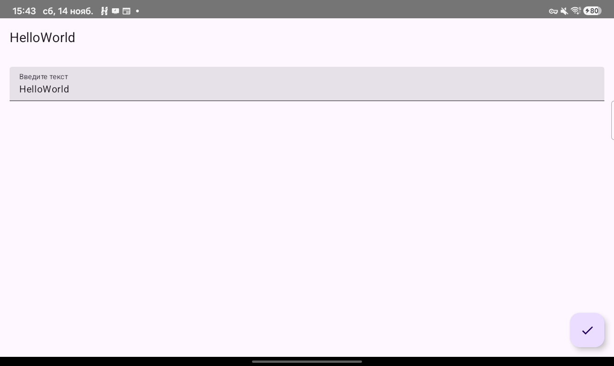

# TextField на Jetpack Compose

Учебный проект: ввод текста с сохранением состояния в ViewModel, TopAppBar и FloatingActionButton.

## Возможности

- Поле ввода текста с подсказкой `Введите текст`.
- Введённый текст отображается в заголовке TopAppBar только после нажатия FloatingActionButton.
- Состояние ввода и заголовка хранится в `TextViewModel` и сохраняется при повороте экрана.

## Скриншот



## Файлы

- `app/src/main/java/ru/yandex/practicum/textfield/MainActivity.kt` - экран с Scaffold, TopAppBar, TextField и FAB.
- `app/src/main/java/ru/yandex/practicum/textfield/TextViewModel.kt` - состояние текста и заголовка.

## Сборка

```bash
./gradlew :app:assembleDebug
```

APK: `app/build/outputs/apk/debug/app-debug.apk`.
